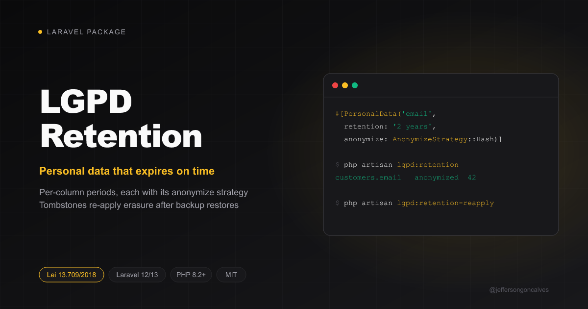

# Laravel LGPD Retention



[](https://packagist.org/packages/jeffersongoncalves/laravel-lgpd-retention)
[](https://github.com/jeffersongoncalves/laravel-lgpd-retention/actions/workflows/tests.yml)
[](https://packagist.org/packages/jeffersongoncalves/laravel-lgpd-retention)

Under the Brazilian General Data Protection Law (LGPD, Lei 13.709/2018), personal data must be eliminated once processing ends (art. 15 and 16). This package reads the `retention` you declared with [laravel-lgpd](https://github.com/jeffersongoncalves/laravel-lgpd)'s `#[PersonalData]`. When a column's period ends, it anonymizes that column, using the column's own strategy.

- **Per column:** each column has its own period. `name` can expire after 1 year while `email` lasts 2.
- **`Keep` columns are nullified when their retention ends.** `Keep` only protects a column from erasure requested by the data subject while a legal duty to store it lasts. Once the retention period is over, that duty is over too.
- **Tombstones:** the package records which column of which record it anonymized, without storing any personal data. Because of that, nothing is anonymized twice (a hash is never hashed again). And after you restore a backup, `lgpd:retention-reapply` erases the data that came back.

> This package gives you tooling. It does not make you compliant on its own. Retention periods need legal review.

## Installation

```bash
composer require jeffersongoncalves/laravel-lgpd-retention
php artisan vendor:publish --tag="lgpd-retention-migrations"
php artisan migrate
```

## Declaring retention

```php
#[PersonalData('name', retention: '1 year', anonymize: AnonymizeStrategy::Mask)]
#[PersonalData('email', retention: '2 years', anonymize: AnonymizeStrategy::Hash)]
#[PersonalData('tax_id', retention: '5 years', anonymize: AnonymizeStrategy::Keep)] // nullified after 5 years
#[PersonalData('notes')]                                                           // no retention: never expires
class Customer extends Model implements HasPersonalData
{
    use InteractsWithPersonalData;
}
```

The period accepts any [CarbonInterval](https://carbon.nesbot.com/docs/#api-interval) string (`'90 days'`, `'5 years'`, ...). It is counted from `created_at`. To count it from another date, implement `HasRetentionStart`. Rows where that date is `null` never expire.

```php
use JeffersonGoncalves\LgpdRetention\Contracts\HasRetentionStart;

class Contract extends Model implements HasPersonalData, HasRetentionStart
{
    public static function retentionStartColumn(): string
    {
        return 'ended_at'; // counts from the end of the contract
    }
}
```

## Usage

```bash
php artisan lgpd:retention --dry-run   # what would be anonymized
php artisan lgpd:retention             # anonymize expired columns
php artisan lgpd:retention-reapply     # after restoring a backup
```

```php
// routes/console.php
Schedule::command('lgpd:retention')->daily();
```

### Erasure requested by the data subject (DSAR)

A model may be anonymized outside this package, for example by [laravel-lgpd-dsar](https://github.com/jeffersongoncalves/laravel-lgpd-dsar)'s `erase()` or by calling `$model->anonymizePersonalData()` directly. Those columns get tombstones too, so `lgpd:retention-reapply` also erases them when a backup brings them back. The listener for laravel-lgpd's `PersonalDataAnonymized` event records them, and you don't need to configure anything. The DSAR erasure skips `Keep` columns, so they get no tombstone, and they are still nullified when their own retention ends.

You can also call it from code: `LgpdRetention::apply(dryRun: false)` returns one row per model and column with the number of records it anonymized. `LgpdRetention::reapply()` returns how many columns it erased again.

## Testing

```bash
composer test
```

## Changelog

See [CHANGELOG](CHANGELOG.md).

## License

The MIT License (MIT). See [License File](LICENSE.md).
